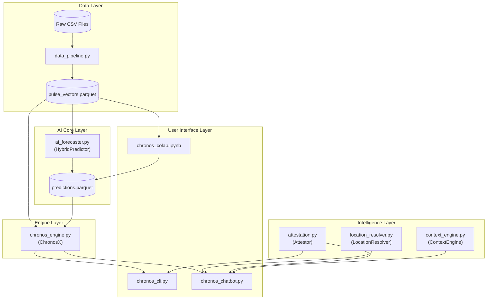

# Chronos-X Codebase Analysis

This document provides a detailed breakdown of each script in the Chronos-X repository, outlining its purpose, key functions, and its role in the overall application architecture.

---

## Core Modules (`src/`)

---

### `src/data_pipeline.py`

#### Purpose

This script is the foundational ETL (Extract, Transform, Load) pipeline for the entire application. Its primary responsibility is to ingest raw, separate CSV datasets for biometric, demographic, and enrolment updates, and transform them into a unified, feature-engineered dataset called the "Pulse Vector" table. This table is the single source of truth for the AI forecasting models.

#### Key Functions

-   **`normalize_state_names(df)`**: Cleans and standardizes the 'state' column in the DataFrames. It handles variations in spelling, casing, and old state names (e.g., 'Orissa' to 'Odisha').

-   **`load_dataset(dataset_type)`**: Loads all CSV files of a specific type (biometric, demographic, or enrolment) from their respective directories and concatenates them into a single Polars DataFrame.

-   **`parse_and_normalize_date(df)`**: Parses the date column from the format 'DD-MM-YYYY' and truncates it to the first day of the month. This standardizes the time series data to a monthly frequency.

-   **`aggregate_by_pincode_month(df, config)`**: Groups the data by pincode and month, then sums the relevant signal column (e.g., 'bio_age_17_') to create a monthly signal for each pincode.

-   **`fuse_datasets(bio_df, demo_df, enrol_df)`**: Performs an inner join on the three aggregated DataFrames (biometric, demographic, and enrolment) using `pincode` and `month` as the composite key. This creates the master table.

-   **`compute_pulse_vector(df)`**: Calculates the normalized "Pulse Vector" for each row. It uses z-score normalization on the raw signals to create the `growth_norm`, `flow_norm`, and `labor_norm` columns.

-   **`load_and_fuse_data()`**: The main function that orchestrates the entire pipeline, calling the other functions in the correct order.

-   **`export_to_parquet(df, filename)`**: Saves the final, processed DataFrame to a Parquet file (`pulse_vectors.parquet`), which is a highly efficient columnar storage format.

#### Inter-Script Connections

-   **Input**: Reads raw CSV files from the `data/` directory.
-   **Output**: Produces the `data/output/pulse_vectors.parquet` file.
-   **Consumed by**:
    -   `src/ai_forecaster.py`: The `HybridPredictor` class loads this Parquet file to get the historical data needed for forecasting.
    -   `src/chronos_engine.py`: The `ChronosX` class also loads this file to provide data to the `HybridPredictor`.

---

### `src/ai_forecaster.py`

#### Purpose

This script contains the core artificial intelligence and machine learning logic of the Chronos-X application. It is responsible for generating predictions. It implements a hybrid forecasting strategy that combines a pre-trained deep learning model (Amazon Chronos T5) with a novel, data-driven approach called "Spatial Parallel Search."

#### Key Functions

-   **`AIForecaster` class**:
    -   `forecast_pin(pin_history, horizon, num_samples)`: Takes a time series for a single pincode and uses the Amazon Chronos T5 model to generate a probabilistic forecast for the specified horizon. It returns the median, lower, and upper bounds of the prediction.
    -   `forecast_pulse_vector(pulse_table, pincode, horizon)`: Forecasts all three components of the Pulse Vector (growth, flow, and labor) for a given pincode.

-   **`find_spatial_parallels(target_pin, target_month, pulse_table, k)`**: This function implements the "Spatial Parallel Search." It takes a target pincode and finds the `k` most similar pincodes from *other states* based on the cosine similarity of their Pulse Vectors in a given month.

-   **`predict_from_parallels(...)`**: Uses the parallels found by `find_spatial_parallels` to make a prediction. It looks at what actually happened to the parallel pincodes in the following month and calculates a weighted average to predict the outcome for the target pincode.

-   **`HybridPredictor` class**:
    -   `__init__(self, model_name)`: Initializes the predictor, including the `AIForecaster`.
    -   `load_pulse_table(self, path)`: Loads the `pulse_vectors.parquet` file.
    -   `predict(self, pincode, ...)`: The main prediction function. It orchestrates the hybrid approach by:
        1.  Getting the current state of the pincode.
        2.  Calling `find_spatial_parallels` to get similar regions.
        3.  Calling `predict_from_parallels` to get the spatial prediction.
        4.  Calling the `AIForecaster` to get the AI-based forecast.
        5.  Combining the spatial and AI predictions into a final "ensemble" prediction.

#### Inter-Script Connections

-   **Input**:
    -   Reads `data/output/pulse_vectors.parquet`, which is produced by `src/data_pipeline.py`.
-   **Consumed by**:
    -   `src/chronos_engine.py`: The `ChronosX` class instantiates the `HybridPredictor` to access its prediction capabilities.
    -   `chronos_cli.py`: The CLI can indirectly trigger the `HybridPredictor` via the `ChronosX` engine.
    -   `chronos_chatbot.py`: The chatbot uses the `HybridPredictor` to get the data it needs to answer user questions.

---

### `src/chronos_engine.py`

#### Purpose

This script acts as a high-level wrapper or an API layer for the core AI functionalities. It provides a simplified interface for the user-facing applications (like the CLI and the chatbot) to get predictions. It also introduces a caching layer, allowing it to serve pre-computed predictions for faster responses.

#### Key Functions

-   **`ChronosX` class**:
    -   `__init__(self, predictions_path)`: Initializes the engine. It loads a pre-computed predictions file (if it exists) and also creates an instance of the `HybridPredictor` from `ai_forecaster.py` for on-demand predictions.
    -   `_load_cache(self)`: Loads the pre-computed predictions from a Parquet file.
    -   `lookup(self, pincode)`: Performs a fast lookup for a pincode in the cached predictions.
    -   `predict_future(self, pincode, horizon)`: This is the main prediction method. It implements a cache-first strategy:
        1.  It first tries to find the prediction in the cache using `lookup`.
        2.  If the prediction is not in the cache, or if the requested `horizon` is longer than what's cached, it falls back to using the `HybridPredictor` to generate a prediction in real-time.
    -   `get_attestation_context(self, pincode)`: Prepares a dictionary of all the information about a pincode, which can then be passed to the `Attestor` to generate a human-readable explanation.

#### Inter-Script Connections

-   **Input**:
    -   Optionally reads `data/output/predictions.parquet` as a cache.
-   **Internal Dependencies**:
    -   Instantiates and uses the `HybridPredictor` from `src/ai_forecaster.py`.
-   **Consumed by**:
    -   `chronos_cli.py`: The CLI uses the `ChronosX` engine to fetch predictions.
    -   `chronos_chatbot.py`: The chatbot uses the `ChronosX` engine to get the context it needs to answer user questions.

---

### `src/location_resolver.py`

#### Purpose

This script is a utility that translates human-friendly location names (like "Delhi" or "Mumbai") into the corresponding 6-digit PIN codes that the rest of the application uses. This makes the chatbot and CLI much more user-friendly. It includes advanced features like fuzzy matching and city abbreviation support.

#### Key Functions

-   **`LocationResolver` class**:
    -   `__init__(self, pulse_table_path)`: Initializes the resolver with:
        1.  **Static Mode**: Uses hardcoded dictionaries (`STATE_PIN_PREFIXES`, `CITY_TO_STATE`, `CITY_ABBREVIATIONS`) to map locations to PIN prefixes.
        2.  **Dynamic Mode**: If a `pulse_table_path` is provided, it loads the `pulse_vectors.parquet` file to get a list of all *actual* PIN codes present in the dataset.
    -   `resolve(self, query)`: The main function. It takes a query string and tries to resolve it by checking if it's a PIN code, a city (including abbreviations), or a state. It uses the available data (static or dynamic) to return a list of matching PIN codes.
    -   `_fuzzy_match(self, query, candidates)`: Implements fuzzy matching using Levenshtein distance to handle typos and misspellings in location queries.
    -   `get_state_for_pin(self, pincode)`: A reverse lookup that returns the state for a given PIN code.

#### Inter-Script Connections

-   **Input**:
    -   Optionally reads `data/output/pulse_vectors.parquet` for dynamic resolution.
-   **Consumed by**:
    -   `chronos_chatbot.py`: The chatbot uses the `LocationResolver` to understand user queries that mention locations by name.

---

### `src/attestation.py`

#### Purpose

This script is responsible for the natural language processing (NLP) and generation (NLG) capabilities of the application. It uses a large language model (LLM) via an OpenAI-compatible API to perform two key tasks:

1.  **Explanation**: It generates human-readable, qualitative explanations of the quantitative predictions made by the AI models.
2.  **Query Parsing**: It parses the user's input in the chatbot to extract structured information, such as the location, time horizon, and intent.

#### Key Functions

-   **`Attestor` class**:
    -   `__init__(self, model, api_key, base_url)`: Initializes the OpenAI API client.
    -   `parse_query(self, user_message)`: Takes a raw user query and sends it to the LLM with a specialized "parser prompt". The LLM then returns a JSON object containing the extracted location, horizon, and intent. Includes local fallback parsing for offline/API-failure scenarios.
    -   `chat(self, user_message, context, history)`: This is the core function for the chatbot's conversational AI. It takes the user's message, injects the relevant data `context` (from the `ChronosX` engine), and the conversation `history`, then sends it all to the LLM to generate a helpful, data-driven response.
    -   `explain_prediction(self, target_pin, parallels, prediction)`: A legacy function used by the CLI to generate a simple, three-sentence explanation of a prediction.

#### Inter-Script Connections

-   **Internal Dependencies**:
    -   Uses the `openai` library to communicate with an LLM API.
-   **Consumed by**:
    -   `chronos_cli.py`: Uses the `explain_prediction` method to provide a summary of the forecast.
    -   `chronos_chatbot.py`: Uses the `Attestor` class extensively for both parsing user queries and generating responses.

---

### `src/context_engine.py`

#### Purpose

This script implements the **Contextual Intelligence Layer** for the Chronos-X application. It injects qualitative context (such as calendar events, seasonal drivers, and local news) into forecasts *without* modifying the underlying quantitative predictions. This enriches the AI's explanations by providing real-world context for why certain patterns might be occurring.

#### Key Functions

-   **`ContextEngine` class**:
    -   `__init__(self)`: Initializes the context engine with a logger.
    -   `get_context(self, pincode, target_month, run_search)`: The main function that generates contextual intelligence for a prediction. It returns:
        -   `seasonal_drivers`: A list of active seasonal factors (e.g., harvest seasons, school admissions).
        -   `local_events`: News/events from web search (if `run_search=True`).
    -   `_get_calendar_events(self, date)`: Maps a given month to active seasonal drivers based on India's agricultural and educational calendar:
        -   **School Admissions (Mar-Jun)**: Linked to Growth Signal (0-5y child enrolments).
        -   **Kharif Harvest (Oct-Nov)**: Linked to Flow & Labor Signal (migrant labor movement).
        -   **Rabi Harvest (Mar-Apr)**: Secondary harvest, moderate labor migration.
        -   **MBU Deadlines (Year-round)**: Mandatory Biometric Updates for 5y/15y age clusters.
    -   `_search_events(self, pincode, date)`: Wrapper for live web search (mock mode for demo stability). Provides deterministic "news" for specific regions like Punjab (harvest) or Bangalore/Delhi (school admissions).

-   **`context_engine`**: A singleton instance exported for easy import across the application.

#### Inter-Script Connections

-   **Internal Dependencies**:
    -   Uses standard Python `datetime` and `logging` libraries.
-   **Consumed by**:
    -   `src/attestation.py`: The context is injected into the LLM's system prompt to enrich responses.
    -   `chronos_chatbot.py`: The chatbot integrates context into its query processing flow.

---

## User Interface Scripts

---

### `chronos_cli.py`

#### Purpose

This script provides a command-line interface for getting a "one-shot" prediction for a specific PIN code. It's a quick way for a power user to get a forecast without the conversational overhead of the chatbot.

#### Key Functions

-   **`main()`**:
    -   Parses command-line arguments (primarily `--pincode`).
    -   Initializes the `ChronosX` engine.
    -   Calls the engine to get a prediction for the specified pincode.
    -   Formats and prints the prediction to the console, including the parallel matches, the AI forecast, and the attestation.

#### Inter-Script Connections

-   **Internal Dependencies**:
    -   `src/chronos_engine.py`: Instantiates `ChronosX` to get predictions.
    -   `src/attestation.py`: Instantiates `Attestor` to get the final explanation.

---

### `chronos_chatbot.py`

#### Purpose

This script provides a full-featured, interactive chatbot that allows users to query the Chronos-X system using natural language. It maintains a conversation history and a context (the current pincode being discussed). Features include **self-healing** (graceful degradation on API failures), **input sanitization**, and **comparison support** for analyzing multiple regions.

#### Key Functions

-   **`ChronosChatbot` class**:
    -   `__init__(self, initial_pincode)`: Initializes the chatbot, including the `ChronosX` engine, the `Attestor`, the `LocationResolver`, and the `ContextEngine`.
    -   `_set_context(self, pincode)`: Sets the current focus of the conversation to a specific pincode and loads the relevant data using the `ChronosX` engine.
    -   `_sanitize_input(self, user_input)`: Cleans and validates user input to prevent injection and handle Unicode/encoding issues.
    -   `process_query(self, user_input)`: This is the main logic loop for a single turn of the conversation. It:
        1.  Sanitizes the user's input.
        2.  Uses the `Attestor` to parse the user's query (with local fallback on failure).
        3.  Uses the `LocationResolver` to figure out which pincode the user is asking about.
        4.  Calls `_set_context` if the pincode has changed.
        5.  Integrates context from `ContextEngine`.
        6.  Uses the `Attestor`'s `chat` method to generate a data-driven response.
    -   `run(self)`: The main REPL event loop that waits for user input and calls `process_query`.

#### Inter-Script Connections

-   **Internal Dependencies**:
    -   `src/chronos_engine.py`: Instantiates `ChronosX` to get the data context for predictions.
    -   `src/attestation.py`: Instantiates `Attestor` to parse queries and generate responses.
    -   `src/location_resolver.py`: Instantiates `LocationResolver` to understand location names in user queries.
    -   `src/context_engine.py`: Integrates seasonal/calendar context into responses.

---

### `chronos_colab.ipynb`

#### Purpose

This Jupyter notebook is designed to run in Google Colab for cloud-based batch prediction generation. It allows users to generate the `predictions.parquet` cache file using cloud GPU resources, which is especially useful when running the full Amazon Chronos T5 model.

#### Key Functions

1.  **Environment Setup**: Installs required dependencies (`chronos-forecasting`, `polars`, etc.) in the Colab environment.
2.  **Data Upload**: Provides instructions for uploading the `pulse_vectors.parquet` file to the Colab runtime.
3.  **Model Loading**: Loads the Amazon Chronos T5 model on available GPU hardware.
4.  **Batch Prediction**: Iterates through all PIN codes and generates hybrid predictions (AI + Spatial Parallels).
5.  **Export**: Saves the resulting predictions to `predictions.parquet` for download.

#### Inter-Script Connections

-   **Input**:
    -   `data/output/pulse_vectors.parquet`: The processed Pulse Vector table.
-   **Output**:
    -   `predictions.parquet`: The pre-computed predictions cache used by `chronos_engine.py`.

---

## Utility Scripts (`scripts/`)

These scripts are used for data analysis, debugging, and batch processing. They are not part of the core application flow but are essential for development and operations.

---

### `scripts/batch_predict.py`

#### Purpose

Generates predictions for **all PIN codes** in the dataset using the `HybridPredictor`. This is the primary script for creating the `predictions.parquet` cache file locally (as opposed to using `chronos_colab.ipynb` in the cloud).

#### Key Functions

-   **`main()`**:
    1.  Loads the `pulse_vectors.parquet` file.
    2.  Initializes the `HybridPredictor` with the Amazon Chronos T5 model.
    3.  Iterates through all unique PIN codes from the reference month.
    4.  For each PIN, generates:
        -   Hybrid prediction (AI + Spatial) for the next month.
        -   6-month AI forecast with confidence intervals.
        -   Parallel match information (similar regions in other states).
    5.  Saves all results to `data/output/predictions.parquet`.
    6.  Prints progress updates and final statistics.

#### Output Format

The generated Parquet file contains:
-   `pincode`, `state`: Identification fields.
-   `current_growth`, `current_flow`, `current_labor`: Current Pulse Vector values.
-   `next_growth`, `next_flow`, `next_labor`: Next month ensemble predictions.
-   `forecast_growth`, `forecast_flow`, `forecast_labor`: 6-month forecast arrays (as JSON strings).
-   `confidence`, `parallel_states`, `top_parallel_1/2/3`: Spatial parallel information.

---

### `scripts/analyze_feasibility.py`

#### Purpose

Validates the data pipeline's feasibility by testing whether the biometric, demographic, and enrolment datasets can be successfully joined. This is crucial for verifying that the datasets have overlapping PIN codes and dates.

#### Key Functions

-   **`analyze()`**:
    1.  Loads sample files from each dataset category (biometric, demographic, enrolment).
    2.  Parses and normalizes dates to monthly frequency.
    3.  Aggregates data by `(pincode, month)`.
    4.  Performs inner joins across all three datasets.
    5.  Reports feasibility statistics (row counts, unique PINs, date ranges).

---

### `scripts/analyze_targeted.py`

#### Purpose

A focused version of `analyze_feasibility.py` that analyzes specific files known to have overlapping date ranges. Used for debugging join issues.

#### Key Functions

-   **`analyze()`**:
    1.  Loads specific files with known overlapping dates (e.g., Nov-Dec 2025).
    2.  Performs sequential joins (Bio + Enrol, then + Demo).
    3.  Writes results to `feasibility_result.txt`.

---

### `scripts/scan_metadata.py`

#### Purpose

Scans all CSV files in the data directories and extracts metadata (date ranges, PIN code ranges) for each file. This is essential for understanding the data landscape and identifying which files can be joined.

#### Output

Generates a formatted log file (`docs/logs/metadata_fixed.log`) with columns:
-   Category (Bio/Demo/Enrol)
-   Filename
-   Min/Max Date
-   Min/Max Pincode

---

### `scripts/analyze_parquet.py`

#### Purpose

A quick diagnostic script that reads and summarizes the `pulse_vectors.parquet` file. Used to verify the data pipeline output.

#### Output

Prints:
-   Row count, unique PINs, columns
-   Date range, month count
-   State distribution (top 5)
-   Signal statistics (raw and normalized)
-   Sample rows

---

### `scripts/test_pipeline.py`

#### Purpose

A minimal test script that verifies the data pipeline output by loading and inspecting the `pulse_vectors.parquet` file.

#### Output

Prints:
-   Row count, unique PINs
-   Date range
-   Columns
-   Sample data (first 10 rows)
-   Descriptive statistics

---

### `scripts/read_log.py`

#### Purpose

A utility script for reading log files that may have been created with different encodings (UTF-16 from PowerShell, or UTF-8). Handles encoding detection automatically.

#### Usage

```bash
python scripts/read_log.py [file1] [file2] ...
```

Defaults to reading `docs/logs/analysis_log.txt` and `docs/logs/metadata.log` if no arguments provided.

---

## Overall Application Workflow

The Chronos-X application follows a clear, layered architecture:



### Layer Descriptions

1.  **Data Ingestion**: The process starts with `src/data_pipeline.py`, which takes raw CSV data and transforms it into the `pulse_vectors.parquet` file. This is the foundational data layer.

2.  **AI Core**: `src/ai_forecaster.py` reads the `pulse_vectors.parquet` file and uses its `HybridPredictor` to generate quantitative forecasts. This is the core intelligence layer.

3.  **API/Engine Layer**: `src/chronos_engine.py` acts as a wrapper around the `HybridPredictor`. It simplifies the interface and adds a caching mechanism for performance. This is the main entry point for the user-facing applications.

4.  **NLP Layer**: 
    -   `src/attestation.py` provides natural language understanding and generation capabilities.
    -   `src/context_engine.py` enriches responses with seasonal and calendar context.
    -   `src/location_resolver.py` translates human-friendly location names to PIN codes.

5.  **User Interface Layer**:
    -   `chronos_cli.py` provides a direct, command-line interface to the `ChronosX` engine.
    -   `chronos_chatbot.py` provides a sophisticated, conversational interface with self-healing capabilities.
    -   `chronos_colab.ipynb` enables cloud-based batch prediction generation.

6.  **Utility Layer** (`scripts/`): Supporting scripts for data analysis, debugging, and batch processing operations.

This layered approach ensures a clear separation of concerns, making the application modular, maintainable, and scalable.
